# Chat helper Control v3 — дизайн-система (Figma-ready)

> Интеграции с Figma в среде разработки нет, поэтому файл `.fig` не создавался. Вместо него — спецификация, по которой
> макет собирается в Figma 1:1: токены (`flutter_app/design/tokens.json`), компоненты, сетка, экраны и **скриншоты настоящего
> приложения** (`docs/screenshots/`, рендер реальных виджетов Flutter с реальными ответами API). Код и токены синхронизированы
> тестом `flutter_app/test/unit_test.dart` («theme constants match design/tokens.json»).

## 1. Стиль

**Premium dark + liquid glass.** Глубокий тёмно-синий градиент, мягкие свечения акцентных цветов в углах, полупрозрачные
«стеклянные» карточки с размытием фона (backdrop blur 18), тонкая светлая обводка. Один акцентный градиент
(синий → фиолетовый) для бренда и главных действий. Шрифт Inter (OFL), Material 3.

## 2. Токены (`design/tokens.json`)

### Цвета

| Токен | Значение | Применение |
|---|---|---|
| `color.bg.top` | `#090C1C` | верх фонового градиента, launch screen |
| `color.bg.bottom` | `#16102F` | низ фонового градиента |
| `color.bg.elevated` | `#141833` | диалоги, bottom sheets, snackbar |
| `color.accent.blue` | `#3B82F6` | primary, активные переключатели, графики |
| `color.accent.violet` | `#8B5CF6` | secondary, AI-разделы, Super Admin |
| `color.accent.cyan` | `#22D3EE` | tertiary, инфо-иконки, пилюли команд |
| `color.text.primary` | `#F0F3FF` | основной текст |
| `color.text.secondary` | `#A6B0CE` | подписи, второстепенный текст |
| `color.text.muted` | `#6B7394` | плейсхолдеры, неактивные иконки |
| `color.glass.fill` | `#0FFFFFFF` (белый 6 %) | заливка стеклянных карточек и полей |
| `color.glass.border` | `#1FFFFFFF` (белый 12 %) | обводка карточек, разделители |
| `color.glass.highlight` | `#2EFFFFFF` (белый 18 %) | обводка outline-кнопок, трек выключенного switch |
| `color.status.success` | `#34D399` | подключено, успех |
| `color.status.warning` | `#FBBF24` | предупреждения, тариф, Mute |
| `color.status.danger` | `#F87171` | ошибки, опасные действия, опасные права |
| `color.status.info` | `#60A5FA` | информационные статусы |

Градиент бренда: `blue → violet`, 135°. Фон экрана: `bg.top → bg.bottom` сверху вниз + два радиальных свечения
(синее 320 px слева сверху и фиолетовое 380 px справа снизу, 28 % → 0 %).

### Радиусы, отступы, размытие

| Радиусы | | Отступы (space) | | 
|---|---|---|---|
| `sm` | 10 | `xxs` 4 · `xs` 8 · `sm` 12 | `md` 16 · `lg` 20 · `xl` 24 · `xxl` 32 |
| `md` | 16 (поля, кнопки) | Боковые поля экрана | 16 |
| `lg` | 24 (карточки) | Между карточками | 12 |
| `pill` | 999 (чипы, пилюли) | Blur стекла | 18 |

### Типографика (Inter)

| Стиль | Размер / вес | Где |
|---|---|---|
| Display (`headlineMedium`) | 28 / Bold | приветствие, заголовок экрана в теле |
| Title (`titleLarge`, AppBar) | 20 / Bold | заголовки AppBar и sheet |
| Subtitle (`titleMedium`) | 16 / SemiBold | заголовки карточек |
| Body (`bodyMedium`) | 14 / Regular, line-height 1.35 | основной текст |
| Caption (`bodySmall`) | 12 / Regular, `text.secondary` | подписи, подсказки |
| Section header | 12 / SemiBold, CAPS, letter-spacing 1.1 | заголовки секций |

Эмодзи: fallback `Noto Color Emoji`.

## 3. Компоненты (Figma components → Flutter-виджеты, `lib/core/widgets.dart`)

| Компонент | Варианты | Flutter |
|---|---|---|
| **Background** | градиент + 2 свечения | `AppBackground` |
| **Glass Card** | обычная / кликабельная (ripple), padding 16, radius 24 | `GlassCard` |
| **Section Header** | с trailing-элементом / без | `SectionHeader` |
| **Stat Tile** | иконка + число (20/Bold) + подпись; цвет иконки = акцент | `StatTile`, сетка `StatGrid` (2 колонки, 4 на планшете) |
| **Hub Tile** | иконка 36×36 в цветной плашке + подпись + опц. бейдж | `HubTile` |
| **KV Row** | подпись слева (secondary) + значение справа (SemiBold) | `KVRow` |
| **Pill** | цвет: success / warning / danger / cyan / violet; фон 18 %, обводка 45 % | `Pill` |
| **Spark Bars** | столбики по дням, база-трек `glass.highlight` | `SparkBars` |
| **Switch Row** | заголовок + подпись + switch (трек `blue` / `glass.highlight`) | `SwitchRow` |
| **Choice Chips** | одиночный выбор, выбранный — `blue` 35 % | `ChoiceRow` |
| **Buttons** | Filled (primary, высота 48, radius 16), Outlined (`glass.highlight`), Text, Danger (filled `danger`) | Material 3 |
| **Text Field** | заливка `glass.fill`, обводка `glass.border`, фокус `blue` | `InputDecorationTheme` |
| **States** | Loading (спиннер), Empty (иконка 40 + текст), Error (иконка `danger` + текст + «Повторить») | `LoadingView`, `EmptyView`, `ErrorView`, `ApiView` |
| **Dialogs** | подтверждение (обычное / опасное), ввод текста | `confirmDialog`, `promptText` |
| **Brand Mark** | скруглённый квадрат 30 %, градиент бренда, иконка чата, тень violet 45 % | `BrandMark` |

## 4. Сетка и адаптивность

* Мобильный макет: ширина 360–412 dp, поля 16, вертикальный ритм 12.
* Сетки плиток: 2 колонки (< 560 dp), 3–4 колонки на планшете.
* Нижняя «безопасная» зона: 32 dp отступа под последней карточкой; FAB не перекрывает контент (запас 72 dp).

## 5. Экраны (40)

Пользовательские (24): Splash · Offline · Welcome · Pairing · Connection Wizard · Home Dashboard · Chat Manager · Chat Controls ·
Permission Inspector · AI Assistant · AI Twin · AI Playground · AFK · Mute Manager · Protect · Animation Studio · Media Studio ·
Games · Commands (+ песочница) · Reminders · Automation Builder (правила / шаблоны / журнал + конструктор) · Profile (аккаунт,
устройства, делегирование, экспорт) · Statistics · Subscription · Language · Settings.

Super Admin (16): Dashboard · Users · User card · Connections · Permissions & Controls · AI · Media · Games · Commands ·
Payments & Plans & Promo · Analytics · Broadcast · Security · System · Logs · Diagnostics.

Каждый экран имеет состояния **загрузка / пусто / ошибка** (общий `ApiView`), pull-to-refresh и подтверждения для опасных действий
(Mute, удаление данных, аварийная остановка — ввод слова `STOP`, возврат Stars, массовая рассылка, отзыв всех сессий).

### Скриншоты (рендер настоящего приложения)

| | | |
|---|---|---|
| 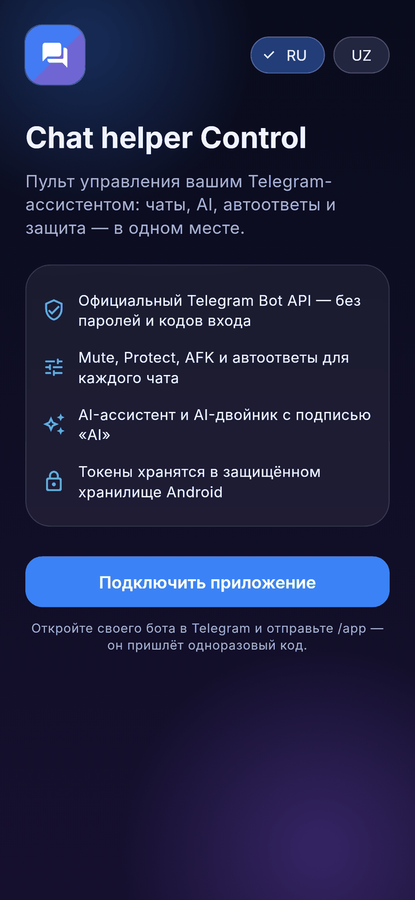 | 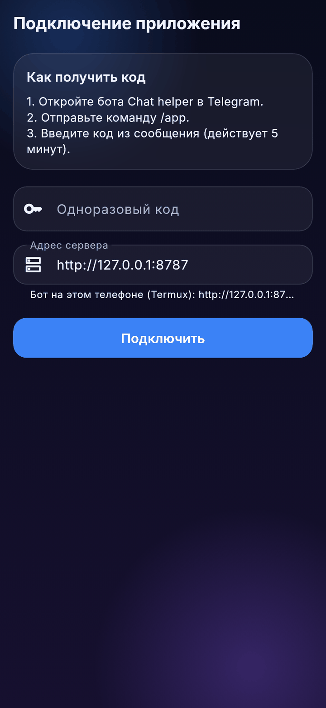 | 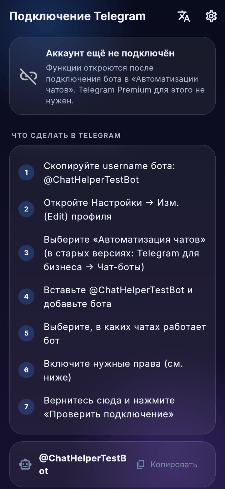 |
| 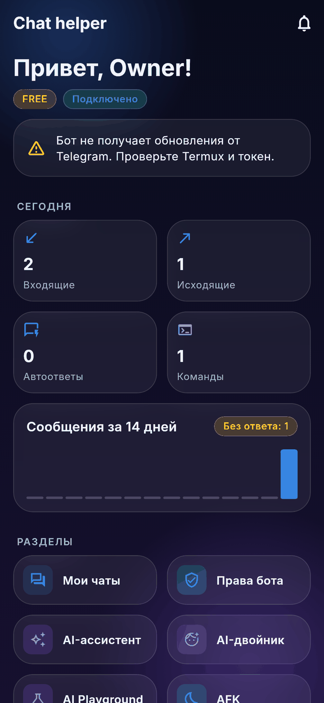 | 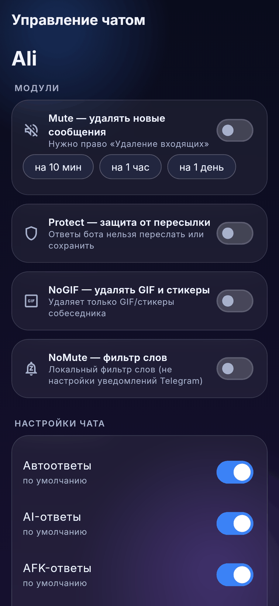 | 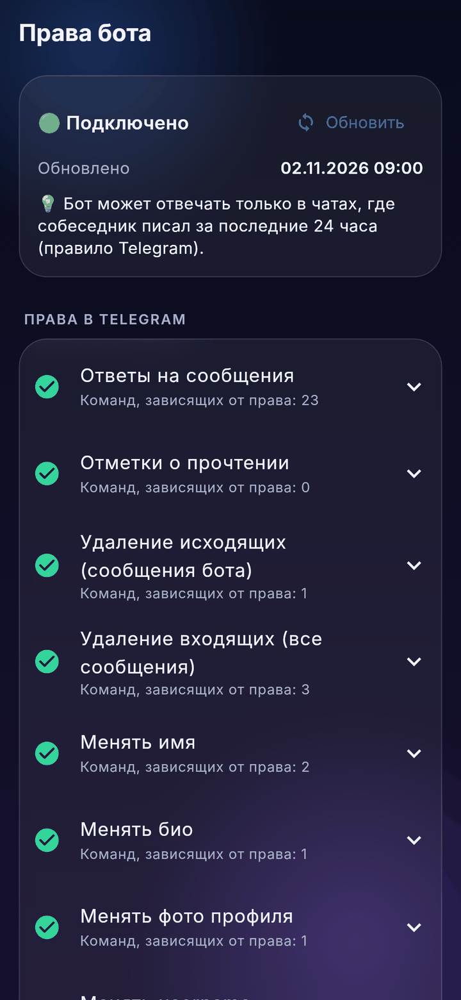 |
| 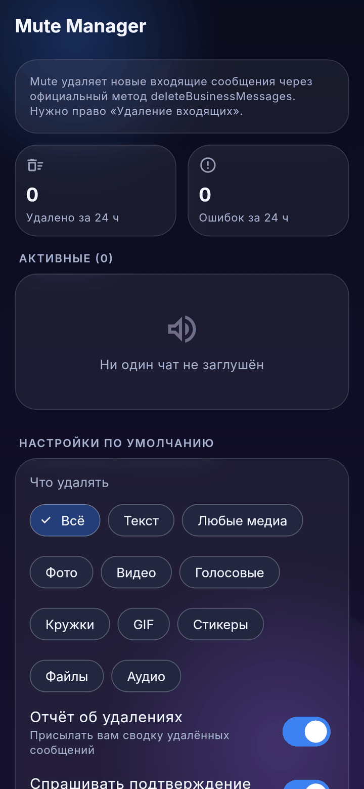 | 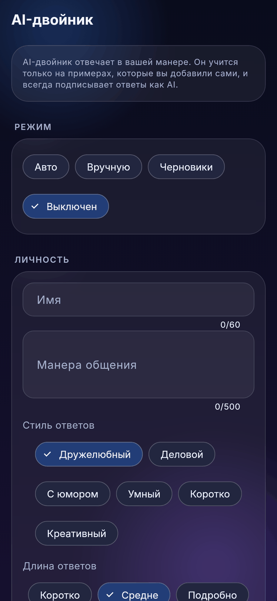 | 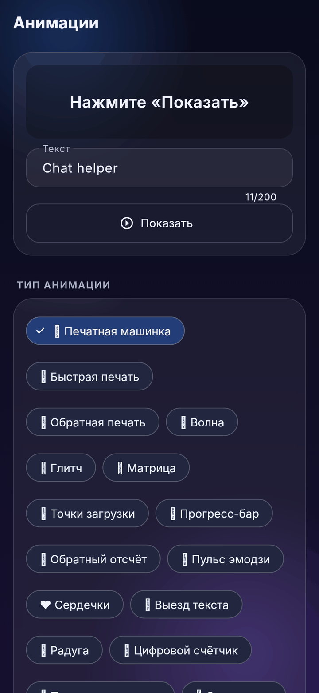 |
| 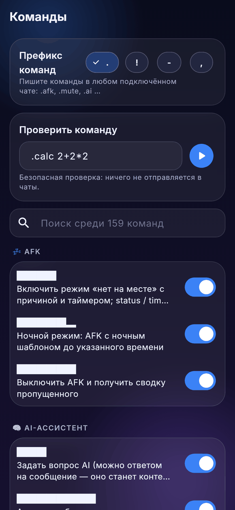 | 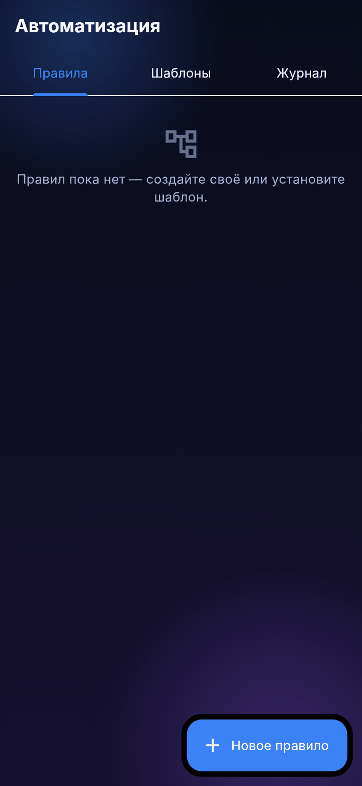 | 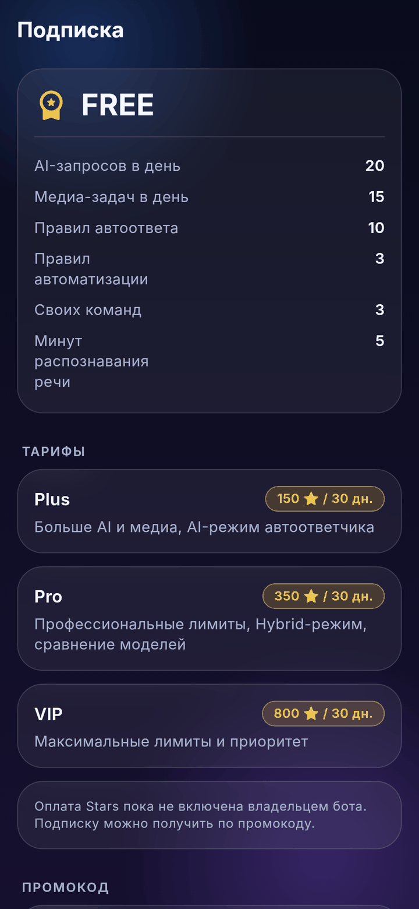 |
| 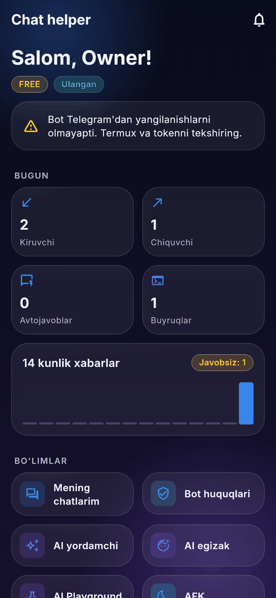 | 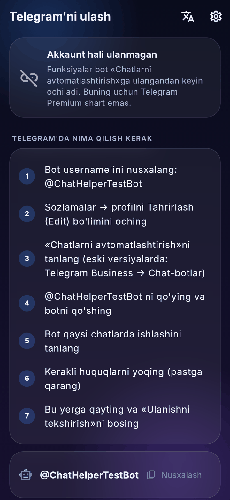 | 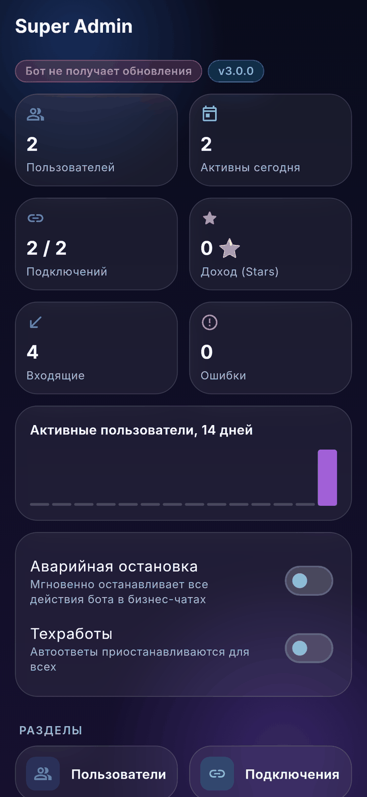 |
| 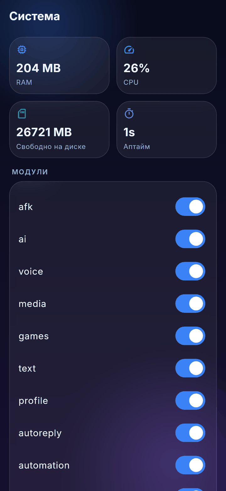 | 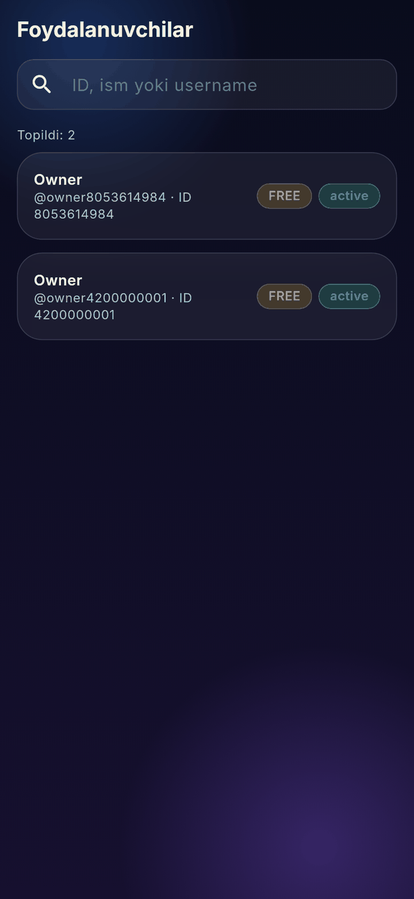 | |

Пересоздать: `cd flutter_app && flutter test --update-goldens --tags screenshots --run-skipped test/screenshots_test.dart`.

## 6. Как собрать файл в Figma

1. Создайте **Variables** из таблицы токенов (коллекции `color`, `radius`, `space`; режим один — Dark).
2. Подключите шрифт **Inter** (Regular / SemiBold / Bold) и создайте **Text styles** из таблицы типографики.
3. **Effects:** `Glass` = Background blur 18; `Glow/Brand` = Drop shadow violet 45 %, blur 28.
4. Соберите компоненты из раздела 3 (Auto Layout, padding 16, gap 12) с вариантами состояний.
5. Фреймы 412 × 915 (Pixel) на каждый экран из раздела 5; скриншоты из `docs/screenshots/` — референс расположения.
6. Прототип: Welcome → Pairing → Home; Home → разделы; Super Admin доступен только во фреймах «role = super_admin».

## 7. Доступность

* Контраст (WCAG): основной текст `#F0F3FF` на `#141833` — 15.7:1, вторичный `#A6B0CE` — 8.0:1 (AA/AAA). `text.muted` (3.7:1) используется только для плейсхолдеров и неактивных иконок, не для содержимого.
* Минимальная высота интерактивных элементов 48 dp; иконки сопровождаются текстом или `tooltip`.
* Цвет не единственный носитель смысла: статусы дублируются текстом («Подключено», «опасное право»).
